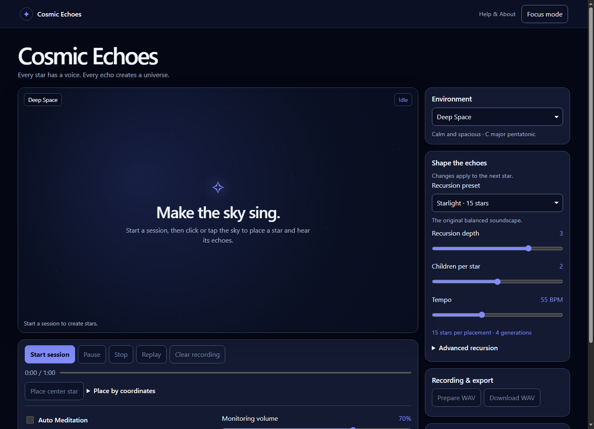

# Cosmic Echoes

**Every star has a voice. Every echo creates a universe.**

Cosmic Echoes is a browser-based instrument for Hub's Quest Epoch 1, the Recursive Soundscapes Solo Hackathon. Place a star and it sends out generations of softer echoes. The same tree shapes the constellation and a slow pentatonic phrase. A few deliberate placements leave space for the melody and ambience to breathe.



## Play and compose

Choose Deep Space, Nebula Dreams or Solar Harmony, select a recursion preset, and press **Start session**. Click the sky or use **Place center star**. Change depth, branching, decay, spread, delay or tempo to shape your next placement. Use **Auto Meditation** for automatic placements and **Focus mode** for a larger sky. Pause, resume, stop and replay, then prepare and download a WAV of the recording.

Each placement grows a bounded tree. Canvas draws its stars, ripples and constellation lines. A musical mapper gives each branch notes related to its parent, and Web Audio keeps the sound and visuals on a shared timeline. Vanilla JavaScript, HTML and CSS run directly in a modern browser. WAV export uses OfflineAudioContext.

## Run locally

```sh
git clone https://github.com/shahariarjoy-1228/Cosmic-Echoes.git
cd Cosmic-Echoes
python -m http.server 8000 --bind 127.0.0.1
```

On Windows, use `py -m http.server 8000 --bind 127.0.0.1` if needed. Open [http://127.0.0.1:8000/](http://127.0.0.1:8000/) and select **Start session**. Use loopback HTTP for JavaScript modules. No build step or package installation is required.

## Explore the project

- [User guide and preset values](docs/USER_GUIDE.md)
- [Recursive algorithm](docs/ALGORITHM.md) and [architecture](docs/ARCHITECTURE.md)
- [Demo scripts](docs/DEMO_SCRIPT.md), [four-slide outline](docs/PRESENTATION.md) and [screenshots and sample WAV](docs/assets/README.md)
- [Hackathon deliverables and judging criteria](docs/HACKATHON_REQUIREMENTS.md)
- [Testing record](docs/TESTING.md), [project plan](docs/PROJECT_PLAN.md) and [progress log](docs/PROGRESS_LOG.md)

The root interface lives in `index.html`, `style.css` and `app.js`. Engine modules live in `js/`, browser test pages in `tests/`, and developer docs and demonstration evidence in `docs/`.

## Verification and AI use

Phase 10 established a developer-approved release candidate within the tested scope. Edge passed 179 automated checks with zero failures and zero skips, Chrome passed 14 supplementary checks, and the developer reported 50/50 final manual checks. Physical mobile touch, screen-reader behavior and physical audio-to-display latency remain unverified. [Evidence and limitations](docs/TESTING.md).

Phase 11 documentation and demonstration preparation is complete and developer-approved. Rehearsal is pending, and original AI transcript recovery remains a submission blocker. Phase 12 preparation is complete within the available evidence. Official rules verification and final submission remain open. The feature freeze remains in effect. The developer directed and manually tested the project, with ChatGPT and Codex assisting across planning, development and verification. [AI use and recovery status](docs/AI_USAGE.md) · [Prompt chain](PROMPT_CHAIN.md) · [Submission preparation](docs/SUBMISSION.md).
